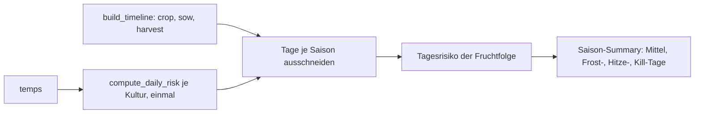

# Plan: Fruchtfolgen bewerten und die Daten dafür bereitstellen

## Top-Level Overview

**Ziel:** Für eine Fruchtfolge (mindestens 3 Jahre, Kulturen dürfen sich wiederholen) gibt es
1. mehrere **einzelne, vergleichbare Scores** (Wasser, Temperaturrisiko, später weitere, z. B. Nährstoff-Score),
2. **einfach nutzbare Daten** für eine Visualisierung, die andere bauen: Wasserverbrauch pro Tag und die Stress-Tage dazu,
3. eine Grundlage, auf der ein **Optimizer** Fruchtfolgen auswählt und vergleicht.

Eine Visualisierung gehört **nicht** zu diesem Plan. Es gibt keinen Zeichencode und keine Grafikbibliothek. Der Plan liefert nur Dateien und eine Beschreibung der Spalten.

**Ausgangslage (im Code geprüft):**
- [`water_usage.py`](water_usage/water_usage.py) rechnet die Wasserbilanz für eine Fruchtfolge. `build_timeline()` legt fest, welche Kultur wann steht (Aussaat bis Ernte, dazwischen Brache). `simulate()` liefert die Tagestabelle mit `crop`, `stage`, `etc`, `precipitation`, `irrigation_need`. `rotation_irrigation_need()` summiert den Bedarf pro Zyklus. Eine Verlustfunktion gibt es nicht.
- [`risk_score/`](risk_score/README.md) bewertet das Temperaturrisiko pro Kultur und Saatjahr. Es mittelt über alle Aussaattage im NASS-Fenster und endet bei `harvest_begin`. Die Tagesebene (`compute_daily_risk` in [`severity.py`](risk_score/severity.py)) ist unabhängig von der Saison und liefert schon `frost_severity`, `heat_severity`, `kill`, `stress_flag` und `daily_score`.
- Beide Teile lesen aus `data/base-data/...` und `data/processed/climate_data/...`.
- Die bestehende Ausgabe von `water_usage` ist eine Long-Datei (`lat`, `lon`, `date`, `crop`, `harvest_year`, `stage`, `parameter`, `value`, `unit`) unter `data/processed/water_usage/`. Das ist die Konvention für die neuen Dateien.

**Kernproblem:** Die beiden Scorer bewerten heute nicht dieselben Tage. Wasser folgt `build_timeline` (feste Aussaat in der Mitte des Fensters bis zur Mitte des Erntefensters). Das Risiko läuft über jeden Aussaattag im Fenster bis `harvest_begin`.

**Ansatz:**
1. `build_timeline` ist die Quelle der Wahrheit für Saisons. Alle Kriterien bewerten genau diese Tage.
2. Der Risk-Score wird auf Tagesebene entlang der Fruchtfolge berechnet und mit der Wasser-Tagestabelle zusammengeführt. Es entsteht **eine Tagestabelle pro Fruchtfolge und Startjahr**.
3. Alles leitet sich aus dieser Tabelle ab: die Daten für die Visualisierung, die Scores (Aggregation) und die Prüfung.
4. Die Scores werden pro Kriterium aggregiert und normiert, aber nicht gewichtet. Der Optimizer gewichtet.
5. Die bestehenden Scorer bleiben fachlich unverändert. Neu sind nur dünne Funktionen, die sie für Fruchtfolgen nutzbar machen.

**Leitprinzipien:**
- Auf dem aktuellen Code aufbauen, nichts neu erfinden.
- Anpassbar und verständlich bleiben: wenige kleine Dateien, klare Namen, Docstrings in Englisch wie im Bestand.
- Alles offen halten: Wiederholungen von Kulturen erlaubt, weitere Kriterien ohne Umbau ergänzbar, Einschränkungen des Suchraums nur als optionale Filter.
- Daten einfach bereitstellen: bekanntes Format, eine Datei pro Zweck, jede Spalte dokumentiert.

## Zielbild

```
Fruchtfolge (Kulturfolge) + Startjahr
        │
        ▼
 build_timeline  ──►  Saisons: Kultur, Aussaat, Ernte (gemeinsam für alle Kriterien)
        │
        ├──► Wasserbilanz    ──► Tagesspalten: etc, precipitation, irrigation_need
        └──► Temperaturrisiko ─► Tagesspalten: frost/heat_severity, kill, stress_flag, daily_score
        │
        ▼
 Tagestabelle (eine Zeile pro Tag, beide Scorer nebeneinander)
        │
        ├──► Datei fuer andere: daily (Long-Format) + seasons (Kultur, Aussaat, Ernte)
        │
        ▼
 Aggregation je Kriterium (pro Jahr der Fruchtfolge, Mittel und Worst Case ueber Startjahre)
        │
        ▼
 Normierung (feste Referenz, kleiner ist besser)  ──►  Datei: Scores je Kandidat
        │
        ▼
 Optimizer / Validierung
```

## Entscheidungen

| Thema | Festlegung | Status |
|---|---|---|
| Ebene | Kandidat = geordnete Kulturfolge, Wiederholungen erlaubt | entschieden |
| Saisons | Aus `water_usage.build_timeline`, für alle Kriterien gleich | entschieden |
| Risk-Score | Wird auf der Fruchtfolge-Timeline gerechnet, nicht über das Aussaatfenster | entschieden |
| Bezugsgröße | Pro Jahr der Fruchtfolge (Wasser in mm pro Jahr, Risiko als Tagesmittel). Zyklen unterschiedlicher Länge bleiben erlaubt. | entschieden |
| Richtung | Bei allen Kriterien ist kleiner besser, sonst beim Eintragen umdrehen | entschieden |
| Normierung | Feste Referenz über den gesamten Kandidatenraum | entschieden |
| Gewichtung | Nicht in der Scoring-Schicht, nur im Optimizer | entschieden |
| Visualisierung | Machen andere. Dieser Plan liefert nur Daten. | entschieden |
| Datenformat | Long-Format wie `water_usage` und `climate_data`, mit Hinweis zum Umformen | entschieden |
| Aggregation über Jahre | Mittel und 90. Perzentil. Kein zusätzlicher schlechtester Einzeljahrwert. | entschieden |
| Brache beim Risiko | Kein Wert (leer), nicht 0 | entschieden |
| Stress-Tage | Flags für Frost, Hitze, Kill (Temperatur) und Wasserstress (`irrigation_need` größer 0) | entschieden |
| Größe der Tagesdatei | Alle Kandidaten und Startjahre mit Spalten `candidate` und `start_year`. Begrenzung auf ausgewählte Kandidaten wird später gelöst. | entschieden (später) |

## Sub-Tasks

### 1. Saisons und Fruchtfolge als gemeinsame Grundlage nutzbar machen

- **Intent:** Beide Scorer sollen dieselben Saisons verwenden können. Heute ist `water_usage.py` ein Skript. Seine Funktionen lassen sich aus anderem Code nur umständlich nutzen.
- **Expected Outcomes:**
  - `build_timeline` und `simulate` sind aus anderem Code importierbar.
  - Für eine Kulturfolge und ein Startjahr gibt es eine Funktion, die die Saisons (Kultur, Aussaat, Ernte) liefert.
  - Die Ergebnisse von `water_usage.py` bleiben identisch (Vergleich mit `data/processed/water_usage/irrigation_need_daily_long.csv`).
- **Todo List:**
  1. Prüfen, ob `crop_scorer/water_usage/` als Paket importierbar ist (kein `__init__.py`, `risk_score/` hat eines).
  2. Importierbarkeit herstellen, ohne `main()` zu verändern.
  3. Prüfen, wie sich `build_timeline` bei Wiederholungen (z. B. Weizen, Weizen, Mais) und bei Soja und Sonnenblume verhält. `FAO_ROWS` enthält beides, bisher wurde nur die Testfolge benutzt.
  4. Ergebnis von `main()` vor und nach der Änderung vergleichen.
- **Relevant Context:** [`water_usage.py`](water_usage/water_usage.py) (`build_timeline`, `simulate`, `rotation_irrigation_need`, `FAO_ROWS`), [`risk_score/__init__.py`](risk_score/__init__.py).
- **Status:** `[ ] pending`

### 2. Temperaturrisiko entlang einer Fruchtfolge berechnen (Tages- und Saisonebene)

- **Intent:** Der Risk-Score wird für genau die Tage der Saisons einer Fruchtfolge berechnet, auf Tagesebene und je Saison.
- **Expected Outcomes:**
  - Eine Funktion nimmt die Saisonliste aus Sub-Task 1 und liefert pro Tag der Saison die Risiko-Spalten (`frost_severity`, `heat_severity`, `kill`, `stress_flag`, `daily_score`) und pro Saison Mittel, Frost-, Hitze- und Kill-Tage.
  - Brachetage haben bewusst keinen Risikowert (fehlend, nicht 0).
  - Der bestehende Tages-Score (`compute_daily_risk`) wird wiederverwendet. `risk_score/run.py` und seine Ergebnisse bleiben unverändert.
- **Todo List:**
  1. Neue kleine Datei im Paket `risk_score` (Vorschlag: `rotation.py`). Bestehende Dateien nur lesen und wiederverwenden.
  2. Tages-Score pro Kultur einmal berechnen und für die Saisontage der Fruchtfolge auslesen.
  3. Mittel pro Saison bilden wie in `simulate_seasons` (Summe geteilt durch Saisontage).
  4. Prüfen, dass die Winterweizen-Ruhezeit (1. Nov bis 31. März) und die Kill-Prüfung bei Saisons über den Jahreswechsel stimmen.
  5. Beachten: Die Saison endet in der Wasserbilanz in der Mitte des Erntefensters, im bisherigen Risk-Score bei `harvest_begin`. Die Saisons sind deshalb etwas länger als zuvor. Das gehört in die Dokumentation.
  6. Plausibilität: Ergebnis für die Testfolge gegen `data/processed/crop_risk_score/risk_score_annual.csv` vergleichen (gleiche Größenordnung, Unterschied erklärbar durch feste Aussaat und längere Saison).
- **Relevant Context:** [`severity.py`](risk_score/severity.py) (`compute_daily_risk`), [`seasons.py`](risk_score/seasons.py) (`simulate_seasons`), [`loader.py`](risk_score/loader.py) (`load_temperature_data`), [`config.py`](risk_score/config.py) (`load_crop_configs`).
- **Status:** `[ ] pending`

### 3. Gemeinsame Tagestabelle und Datenausgabe für die Visualisierung

- **Intent:** Beide Scorer nebeneinander auf denselben Tagen, als einfache Datei. Wer eine Grafik baut, soll nur diese Datei lesen müssen.
- **Expected Outcomes:**
  - Eine Funktion `(Kulturfolge, Startjahr) → Tagestabelle` mit einer Zeile pro Tag, auch an Brachetagen (Risiko dort fehlend).
  - Eine Datei im Long-Format unter `data/processed/` (Vorschlag: `rotation_daily_long.csv`). Spalten wie bei `water_usage`: `lat`, `lon`, `date`, dazu `candidate` (Kulturfolge als Text), `start_year`, `crop`, `stage`, `parameter`, `value`, `unit`.
  - Enthaltene Parameter: Wasser (`crop_evapotranspiration`, `precipitation`, `irrigation_need`) und Risiko (`frost_severity`, `heat_severity`, `daily_score`).
  - Stress-Flags als 0 oder 1 pro Tag: `frost_day`, `heat_day`, `kill_day` (aus dem Risk-Score) und `water_stress_day` (`irrigation_need` größer 0, also die Pflanze bekommt weniger als ETc). Auf Brachetagen sind alle Flags leer, denn dort steht keine Kultur.
  - Eine kleine Saisondatei (Vorschlag: `rotation_seasons.csv`) mit `candidate`, `start_year`, `crop`, `sow_date`, `harvest_date`. Sie liefert die Bänder, in denen eine Kultur steht, ohne dass jemand sie aus den Tageswerten rekonstruieren muss.
  - Ein Hinweis, wie man die Long-Datei in eine breite Tabelle umformt (wie im README von `water_usage`).
- **Todo List:**
  1. Neues Paket `crop_scorer/scoring/` anlegen. Datei für die Tagestabelle (Vorschlag: `daily.py`).
  2. Wasser-Tagestabelle aus Sub-Task 1 und Risiko-Tagestabelle aus Sub-Task 2 über das Datum verbinden.
  3. Prüfen, dass beide Teile dieselben Tage und Kulturen haben (einfacher Check, wie `sanity_checks` in `run.py`).
  4. Long-Format, Spaltennamen und Einheiten an die bestehenden Dateien anpassen (`to_long` in `water_usage.py` als Vorlage).
  5. Ausgabegröße prüfen: Alle Startjahre mal viele Kandidaten ergeben große Dateien. Die Datei für einzelne Kandidaten oder eine Auswahl schreibbar machen, statt immer alle.
  6. Datei und Spalten im README beschreiben (Sub-Task 7).
- **Relevant Context:** Sub-Task 1 und 2. [`risk_score/run.py`](risk_score/run.py) (`build_daily_table`, `sanity_checks`) als Vorlage für Aufbau und Checks. [`water_usage.py`](water_usage/water_usage.py) (`to_long`, `DAILY_PARAMS`).
- **Status:** `[ ] pending`

### 4. Kriterienformat, Register und Aggregation

- **Intent:** Jedes Kriterium wird gleich beschrieben und aus der Tagestabelle abgeleitet. Neue Kriterien (z. B. Nährstoff-Score) kommen als Eintrag dazu.
- **Expected Outcomes:**
  - Ein Kriterium hat Name, Einheit, Richtung (kleiner ist besser) und eine Funktion `Tagestabelle → Rohwert`.
  - Zwei Einträge: Bewässerungsbedarf (mm pro Jahr) und Temperaturrisiko (Tagesmittel). Zusätzlich als Info-Spalten: Anzahl Frost-, Hitze- und Kill-Tage.
  - Aggregation über Startjahre: Mittel und 90. Perzentil (kein schlechtester Einzeljahrwert).
  - Kriterien ohne Wert (z. B. Saison außerhalb der Daten) sind als fehlend gekennzeichnet, nicht mit 0 gefüllt.
  - Eine kurze Anleitung beschreibt, wie ein drittes Kriterium ergänzt wird.
- **Todo List:**
  1. Kriterien-Beschreibung und Register in einer Datei (Vorschlag: `criteria.py`).
  2. Bezugsgröße pro Jahr der Fruchtfolge für beide Einträge umsetzen.
  3. Aggregation über Startjahre in einer Funktion. Die Einzelwerte pro Startjahr bleiben erhalten.
- **Relevant Context:** Tagestabelle aus Sub-Task 3. `rotation_irrigation_need()` als Vorlage für die Wasserseite.
- **Status:** `[ ] pending`

### 5. Kandidaten erzeugen, bewerten und normieren

- **Intent:** Aus einer Kulturmenge alle gewünschten Fruchtfolgen bilden, jede in jedem Startjahr bewerten und auf eine gemeinsame Skala bringen.
- **Expected Outcomes:**
  - Kandidaten-Erzeugung für eine Länge, mit Wiederholungen. Filter sind optional und standardmäßig leer. Die Suchraumgröße wird ausgegeben.
  - Eine Scores-Datei unter `data/processed/` im Long-Format: `candidate`, `start_year`, `criterion`, `raw_value`, `unit`, plus eine aggregierte Datei mit einer Zeile pro Kandidat (Rohwert und normierter Wert je Kriterium).
  - Pro Kriterium eine normierte Spalte (0 bis 1, kleiner ist besser) neben dem Rohwert. Die Referenz (Min und Max) kommt aus dem gesamten Kandidatenraum und wird gespeichert. Der Wert eines Kandidaten ändert sich nicht, wenn ein anderer dazukommt.
  - Keine Gewichtung und keine Gesamtsumme in dieser Schicht.
- **Todo List:**
  1. Kulturmenge und Länge als Parameter.
  2. Optionale Filter als einfache Funktionen (z. B. "dieselbe Kultur nicht direkt hintereinander"). Der spätere Nährstoff-Score wäre ein Filter oder ein weiteres Kriterium.
  3. Normierungsverfahren festlegen (Min-Max oder Perzentil-Rang), im Code kurz begründen, Referenz speichern.
  4. Laufzeit messen, bevor Simulationen zwischen Kandidaten mit gleichem Anfang geteilt werden. Erst messen, dann optimieren.
- **Relevant Context:** Sub-Task 4. `water_usage.rotation_irrigation_need` (Schleife über Startjahre).
- **Status:** `[ ] pending`

### 6. Optimierung und Validierung

- **Intent:** Aus den vergleichbaren Scores eine Auswahl ableiten und prüfen, ob sie belastbar ist.
- **Expected Outcomes:**
  - Eine einfache Auswahl auf den normierten Scores: Rangliste mit frei wählbaren Gewichten und eine Pareto-Front.
  - Zeitraum-Split (z. B. 1991–2008 gegen 2009–2025) zeigt, ob eine Fruchtfolge in jüngeren Jahren schlechter wird.
  - Rangstabilität: Bleibt die Reihenfolge, wenn Normierungsverfahren oder Gewichte wechseln?
  - Plausibilitätschecks im Stil von `risk_score/run.py` (`sanity_checks`).
  - Die Tagesdaten aus Sub-Task 3 lassen sich für die besten Kandidaten ausgeben.
- **Todo List:**
  1. Eingaben: Liste von Kandidaten oder "alle".
  2. Auswahlfunktionen klein halten und von der Scoring-Schicht trennen.
  3. Zeitraum-Split und Rangstabilität als getrennte, kurze Funktionen.
  4. Bekannte Grenzen der Scorer (siehe READMEs) in der Ausgabe erwähnen.
- **Relevant Context:** Sub-Task 5. [`risk_score/run.py`](risk_score/run.py).
- **Status:** `[ ] pending`

### 7. Dokumentation

- **Intent:** Das Konzept bleibt für später verständlich, und andere können die Daten ohne Rückfrage nutzen.
- **Expected Outcomes:**
  - `crop_scorer/scoring/README.md`: Ziel, Datenfluss, Aufruf, Ergänzen eines Kriteriums, Normierung und ihre Grenzen.
  - Eine Spaltenbeschreibung für jede Ausgabedatei (Tagesdaten, Saisons, Scores) mit Einheit und Bedeutung. Dazu ein kurzes Beispiel, wie man Wasser und Stress-Tage eines Kandidaten filtert und umformt.
  - Annahmen sind aufgeführt: feste Aussaat, Brache-Annahme, Saisonende in der Mitte des Erntefensters, Wetter nur 1991–2025.
- **Todo List:**
  1. README im Stil von [`risk_score/README.md`](risk_score/README.md) und `data/processed/water_usage/README.md`.
  2. Hinweis, welche Teile der Optimizer nutzt.
- **Status:** `[ ] pending`

## Offene Fragen

Zu klären während der Umsetzung, ohne dass sie den Plan blockieren:

1. **Wasserstress-Flag:** `water_stress_day` ist als `irrigation_need` größer 0 definiert. Bei sehr kleinen Werten (z. B. 0,01 mm) wäre jeder Tag ein Stresstag. Beim Umsetzen eine kleine Schwelle prüfen und im README dokumentieren.
2. **Größe der Tagesdatei:** Bewusst auf später verschoben. Der Plan schreibt zunächst alle Kandidaten und Startjahre.
3. **Umfang des Optimizers:** Sub-Task 6 enthält nur eine einfache Auswahl (Rangliste, Pareto-Front). Ein echter Such-Algorithmus gehört nicht dazu, bei wenigen Kulturen reicht vollständiges Durchprobieren.
4. **Zukunft:** Alle Werte beruhen auf Wetter von 1991 bis 2025. Eine Bewertung für künftiges Klima braucht Szenariodaten und gehört nicht in diesen Plan.

## Nicht Teil dieses Plans

- Visualisierung jeder Art (Zeichencode, Grafikbibliothek).
- Ein Such-Algorithmus über sehr große Suchräume.
- Nährstoff-Score des Bodens (nur als späteres Kriterium vorbereitet).
- Änderungen an den fachlichen Annahmen der Scorer.

---

PRoblem? 
Der Plan in [`rotation-scoring-plan.md`](crop_scorer/rotation-scoring-plan.md) passt zum Code. Ich habe `risk_score/` und die Timeline in [`water_usage.py`](crop_scorer/water_usage/water_usage.py) gelesen. Das ist mein Vorschlag für Sub-Task 2 (Risiko entlang der Fruchtfolge).

## Kernidee

[`compute_daily_risk`](crop_scorer/risk_score/severity.py:55) hängt nur von Wetter und Kultur ab, nicht von der Saison. Das gilt auch für die Winterweizen-Ruhezeit, weil sie über Monat und Tag bestimmt wird (siehe [`in_winter_rest`](crop_scorer/risk_score/severity.py:24)). Deshalb muss pro Kandidat nichts neu simuliert werden:

1. Einmal pro Kultur (5 Stück) den Tages-Risikoverlauf über 1991–2025 berechnen.
2. Für jede Saison `(crop, sow, harvest)` aus `build_timeline` die passenden Tage ausschneiden.
3. Pro Saison aggregieren.



## Konkreter Vorschlag: neue Datei `risk_score/rotation.py`

```python
def daily_risk_by_crop(temps, crops, kill_penalty=DEFAULT_KILL_PENALTY) -> dict[str, pd.DataFrame]:
    """compute_daily_risk once per crop, indexed by date."""

def rotation_daily_risk(seasons, risk_by_crop) -> pd.DataFrame:
    """One row per season day: date, crop, season_idx + risk columns.
    seasons = [(crop, sow, harvest), ...] exactly as returned by build_timeline."""

def rotation_season_summary(daily) -> pd.DataFrame:
    """Per season: season_days, frost_days, heat_days, kill_days, season_score (= sum / days)."""
```

Es gibt keine Zeilen für Brachetage. Beim späteren Join auf die Wasser-Tagestabelle (Sub-Task 3) werden sie automatisch `NaN`. Das entspricht der Entscheidung "Brache = leer, nicht 0".

## Entscheidungen, die ich so treffen würde

- **Keine Abhängigkeit von `risk_score` auf `water_usage`.** `rotation.py` bekommt die Saisonliste als Argument. Erst das neue Paket `scoring/` kennt beide Seiten. So bleibt `risk_score` unabhängig.
- **Tage sind halboffen `[sow, harvest)`.** Das ist dieselbe Konvention wie in `rotation_irrigation_need` ([Zeile 238](crop_scorer/water_usage/water_usage.py:238)) und `crop_calendar`. Dort hat die Saison genau `season_days` Tage. Sonst ist der Risiko-Tag um eins länger als der Wasser-Tag, und der Join-Check in Sub-Task 3 schlägt an.
- **Zähler wie in [`simulate_seasons`](crop_scorer/risk_score/seasons.py:86).** Frost und Hitze zählen nur an Nicht-Kill-Tagen, Kill wird separat gezählt. Das sind drei Zeilen Duplikat. Ich würde `simulate_seasons` nicht umbauen, weil der Plan ausdrücklich verlangt, dass es unverändert bleibt.
- **Saison nur mit vollständigen Daten.** `build_timeline` bricht schon ab, wenn die Ernte nach 2025 läge. Für Startjahre nahe 2025 gibt es dann weniger Saisons. Wie in `rotation_irrigation_need` sollte man Startjahre mit weniger Saisons als der Fruchtfolgelänge auslassen.

## Dinge, die zu prüfen sind

1. **Winterweizen über den Jahreswechsel.** Das Todo Nr. 4 im Plan ist durch die Konstruktion fast erledigt, weil die Ruhezeit pro Kalendertag gilt. Ein Test sollte es trotzdem belegen.
2. **Exakter Vergleich statt nur Größenordnung.** Die Tageswerte für (Kultur, Datum) müssen identisch mit [`risk_score_daily.csv`](crop_scorer/risk_score/run.py:28) sein, weil es dieselbe Funktion ist. Das ist der stärkste und billigste Test. Der Plan sieht bisher nur einen Vergleich mit `risk_score_annual.csv` vor. Der bleibt als Plausibilitätscheck, die Werte weichen dort aber bewusst ab.
3. **Abweichung zu `risk_score_annual.csv` ist erwartbar.** Dafür gibt es zwei Gründe:
   - Die Aussaat ist fest in der Mitte des Fensters, nicht über alle Aussaattage gemittelt.
   - Die Saison endet in der Mitte des Erntefensters statt bei `harvest_begin`.

   Das gehört in die README.
4. **Kill-Penalty dominiert den Mittelwert.** Ein Kill-Tag zählt 100. In einer 200-Tage-Saison sind das +0,5 im Mittel, also mehr als alle Frost- und Hitze-Tage zusammen. Das ist bestehendes Verhalten und gehört nicht in diesen Schritt. Für die Normierung in Sub-Task 5 ist es aber relevant, weil die Verteilung sehr schief wird (viele Saisons nahe 0, wenige Ausreißer). Min-Max-Normierung wäre dann ungünstig, ein Perzentil-Rang eher geeignet.
5. **Brache vor Mais nach Weizen ist lang.** Wenn die Ernte im Sommer liegt und die nächste Aussaat erst im folgenden Frühjahr, bleibt fast ein Jahr ohne Risikowert. Das ist gewollt. Bei der Aggregation "Mittel pro Jahr" muss aber klar sein, ob durch Anbautage oder durch Kalendertage geteilt wird. Ich würde durch Anbautage teilen und die Anzahl Anbautage als eigene Spalte mitgeben.

## Aufwand und Reihenfolge

Das sind etwa 60 bis 80 Zeilen in einer Datei plus ein Test. Bestehende Dateien ändern sich nicht. Vorab müsste Sub-Task 1 geklärt sein, nämlich ob `crop_scorer.water_usage.water_usage` importierbar ist. Es gibt dort kein `__init__.py`, aber das gilt auch für `crop_scorer/` selbst, und der Import `crop_scorer.risk_score...` funktioniert bereits.

Ich bin im Ask-Modus und ändere deshalb nichts. Wenn der Vorschlag so passt, wechsle in den Agent-Modus. Dann setze ich `rotation.py` mit Tests (Identität zu `risk_score_daily.csv`, Jahreswechsel bei Winterweizen, Testfolge Weizen → Mais → Hirse) um.